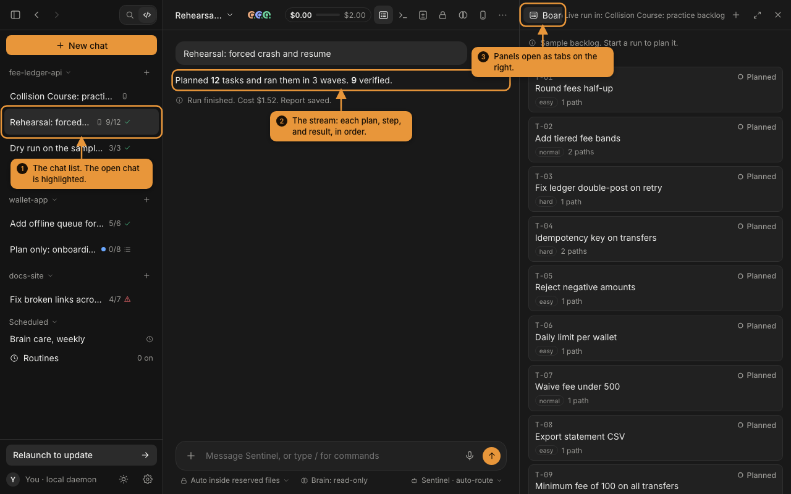
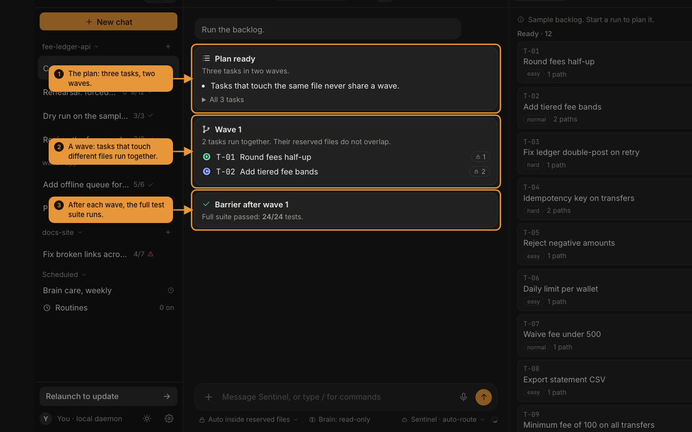
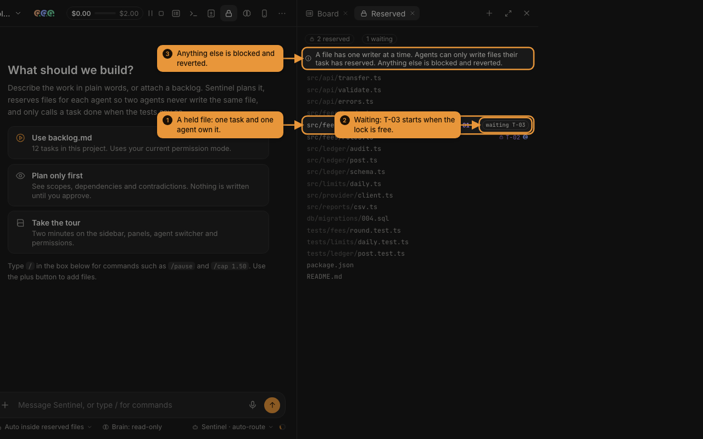
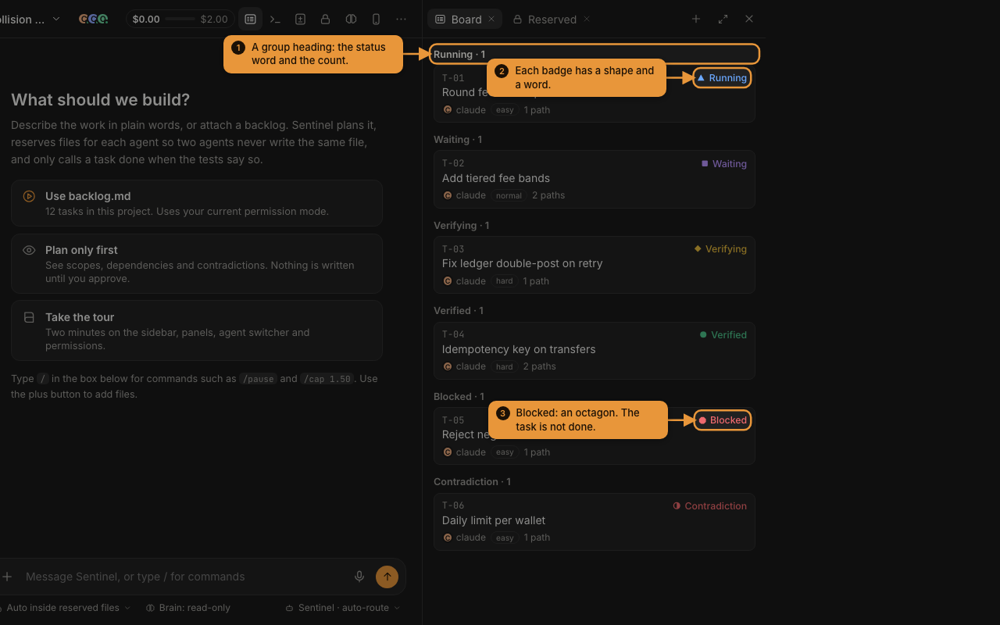
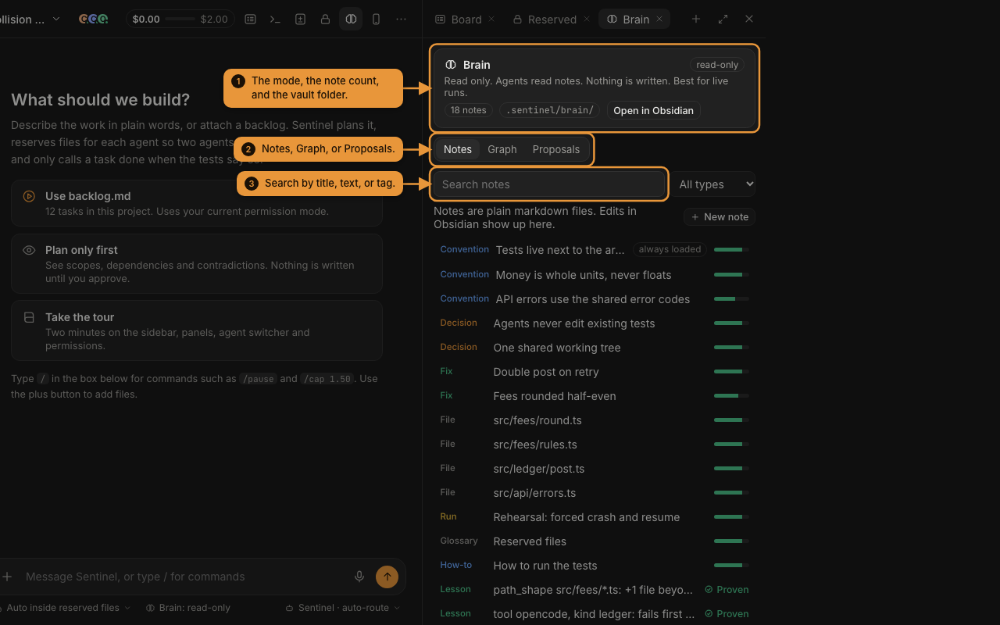
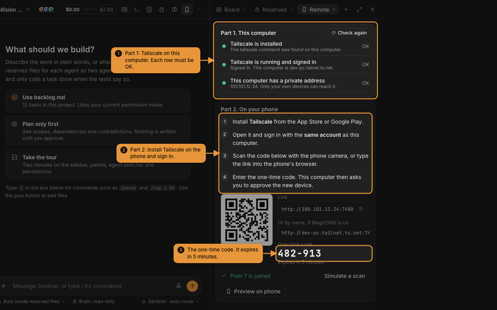

# Sentinel

Sentinel runs many coding agents in one shared working tree without collisions. It verifies every "done" claim, and you can steer it from a phone over Tailscale.

Open the how-to site: <https://khanblair.github.io/sentinel-harness/>

## Install on a Mac

One command in Terminal:

```bash
curl -fsSL https://raw.githubusercontent.com/khanblair/sentinel-harness/main/install.sh | sh
```

It downloads the latest release, checks its SHA-256, and puts Sentinel in Applications. macOS opens it with no warning, because a file fetched with `curl` carries no quarantine flag. The app opens Sentinel in its own window instead of a browser tab. The script is short; read it first at [install.sh](install.sh) if you like.

Or download the disk image by hand: [Sentinel .dmg](https://github.com/khanblair/sentinel-harness/releases/latest) (Apple silicon and Intel). A downloaded image is blocked the first time until the build is signed with a Developer ID certificate: click Done, open System Settings, Privacy & Security, and choose Open Anyway.

## What it does

- **Chats and projects.** You talk to Sentinel in a chat inside a project (a repository). A message starts a run. Attach files, folders, a backlog, or a note with the plus button.
- **Reserved files.** Each task reserves the files it may write. Two agents never write the same file. A write outside the reservation is blocked and restored.
- **Honest status.** A task is Verified only when the tests pass, no existing test was edited, and a second, different agent approved the diff. Anything less is Partial, Blocked, or Skipped, and the report says why.
- **Budget guard.** One cap for the run, a ceiling per task, and a cap that can only be lowered once the run starts.
- **Many agents.** Claude, Codex, Gemini, OpenCode, Goose, Pi, and others through their CLIs, plus a built-in OpenRouter loop.
- **Brain.** A folder of markdown notes (Obsidian compatible) that agents read as memory. Each run can write a journal and lesson candidates.
- **Phone, Telegram, always-on host.** Pair a phone over Tailscale, get approvals and alerts in Telegram, and run the daemon as a service.

## A look at it

These views come from the [how-to site](https://khanblair.github.io/sentinel-harness/). Each one links to its page.

<table>
<tr>
<td width="50%">
<a href="https://khanblair.github.io/sentinel-harness/"></a>
<br><sub><b>Chats and the Board.</b> The chat list, the stream of each plan, step, and result, and the task board.</sub>
</td>
<td width="50%">
<a href="https://khanblair.github.io/sentinel-harness/guides/backlog-safely.html"></a>
<br><sub><b>A run in waves.</b> Tasks that touch different files run together, then the full test suite runs.</sub>
</td>
</tr>
<tr>
<td width="50%">
<a href="https://khanblair.github.io/sentinel-harness/using/reserved-files.html"></a>
<br><sub><b>Reserved files.</b> One writer per file. A task that needs a busy file waits.</sub>
</td>
<td width="50%">
<a href="https://khanblair.github.io/sentinel-harness/reference/status-words.html"></a>
<br><sub><b>Honest status.</b> Each badge has a shape and a word. Only a checked task is Verified.</sub>
</td>
</tr>
<tr>
<td width="50%">
<a href="https://khanblair.github.io/sentinel-harness/brain/index.html"></a>
<br><sub><b>Brain.</b> Plain markdown notes that agents read as memory. Works with Obsidian.</sub>
</td>
<td width="50%">
<a href="https://khanblair.github.io/sentinel-harness/remote/phone.html"></a>
<br><sub><b>Phone pairing.</b> Check Tailscale, scan the code, enter the one-time code, and approve the phone.</sub>
</td>
</tr>
</table>

## Try it

You need Rust (stable), the `wasm32-unknown-unknown` target, `trunk`, and at least one agent CLI (Claude, Codex, Gemini, OpenCode, and others) on your computer.

```bash
rustup target add wasm32-unknown-unknown
(cd crates/sentinel-ui && trunk build)
cargo run -- starter
cargo run -- daemon --repo "$HOME/Sentinel Starter" --dev-bind
```

`starter` makes a small Python project with a three-task backlog, so a first run is cheap. In another terminal, run `cargo run -- open`. It opens the UI signed in as this computer.

Sentinel uses the agent CLIs it finds. Run `cargo run -- scan` to see which ones, and `cargo run -- doctor` to check your setup.

## Run a backlog from the terminal (Collision Course)

This is the one-command run for the hackathon harness. It needs Rust (stable), Node 20 or newer for the practice repository's own tests, and at least 3 agents across 2 tools or models. The UI is not needed: a fresh clone builds without `trunk`.

```bash
export SENTINEL_NO_KEYCHAIN=1   # read keys from the environment only
export OPENROUTER_API_KEY=...   # only when an agent uses OpenRouter
cargo run --release -- run backlog/backlog.json --repo ../collision-course-ledger --cap 5.00 \
  --agents "claude=haiku,opencode=opencode/glm-5.3-flash-free,opencode=opencode/deepseek-v4.1-flash-free"
```

- `--cap` is the hard budget in dollars. The run stops starting tasks at 70 percent of it and kills the workers at 95 percent. A free model spends nothing, a Claude run reports its own cost, and an OpenRouter call returns its usage. An agent that reports no cost is counted by a time guess.
- `--agents` names the agents, cheapest first. `TOOL=MODEL` runs the same tool with another model as a separate agent. The strongest agent writes the plan. The first try of each task rotates across the agents, and a failed try moves to the next stronger one. Run `sentinel scan` to see the tools on your machine.
- `--test-cmd` sets the full suite command. Without it, Sentinel reads `package.json`, `Cargo.toml`, pytest files, `go.mod`, or a Makefile. It never needs npm: a `package.json` test script runs through `sh -c`.
- The backlog is `backlog.json` (`{ "tasks": [{ "id", "title", "body" }] }`) or markdown.

What the run does: it asks the strongest agent for a plan with a scope of files for every task, runs tasks with different files in waves, runs the full suite after each wave, and finds the one task that broke the suite when it fails. A task is Verified only when the suite passes, its new tests fail without the change, no protected file changed, and a second, different agent approved the diff. Two tasks that contradict each other are both skipped, with the reason. A ticket that says it is finished is checked, not trusted. Files in `tests.lock.json` can never change.

The result is in `.sentinel/` of the repository: `report.md` (statuses, reasons, cost, and an Evidence section), `evidence.json`, and `log.jsonl` (every event). `sentinel report --writeup` drafts the one page write-up from them.

Prove the harness catches cheating, with no agent and no money:

```bash
cargo run --release -- selftest
```

It runs seven scripted bad agents (a collider, a tamperer, a liar, an overspender, a crasher, one that needs a file outside its scope, and one that breaks the suite) and prints PASS or FAIL for each.

Dependencies are in `Cargo.toml` and `Cargo.lock`. There is no orchestration framework and no Agent HQ code: the coordination layer (tasks, file reservations, the write guard, waves, the budget guard, resume after a crash, and the verifier) is in `crates/`.

## Checks

```bash
cargo xtask ci
```

It runs format, clippy, tests, cargo-deny, cargo-machete, and the repository checks (smell, duplicates, slop, docs, banned items, contrast).

## Docs

Start with [docs/README.md](docs/README.md). The interactive prototype is `design/sentinel-prototype.html`. Project status is in [docs/progress-tracker.md](docs/progress-tracker.md).

## License

MIT. See [LICENSE](LICENSE).
